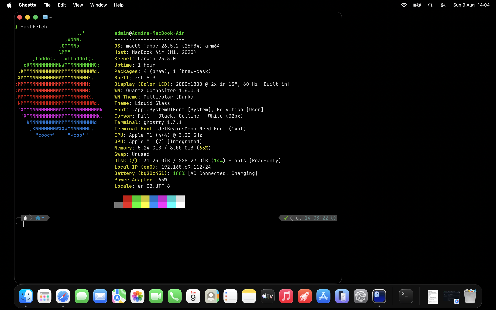
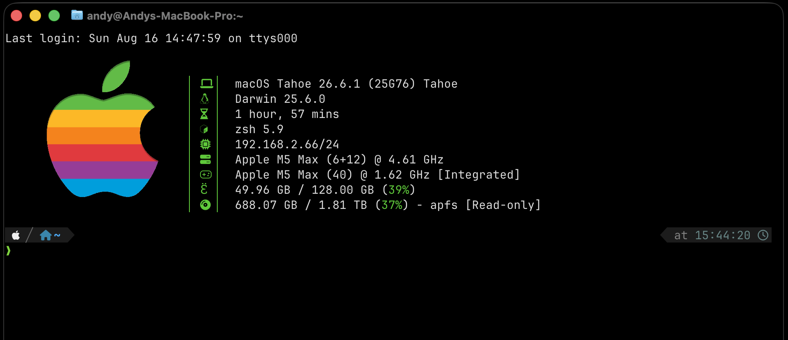

# macos-terminal



One script that sets up a beautiful, fast terminal on a brand-new Mac: **Homebrew**, **Ghostty**, **Oh My Zsh**, **Powerlevel10k** and **Fastfetch** with an Apple-logo theme, installed in the right order with no manual steps.

Based on the walkthrough in [andrewpayne68/macos-terminal-oh-my-ghostty](https://github.com/andrewpayne68/macos-terminal-oh-my-ghostty), turned into a single automated script.

## Install

Paste this into Terminal.app on the Mac:

```bash
curl -fsSL https://raw.githubusercontent.com/andrewpayne68/macos-terminal/main/install-ghostty-terminal.sh | bash
```

Or download it first if you would rather read it before running:

```bash
curl -fsSL -o install-ghostty-terminal.sh https://raw.githubusercontent.com/andrewpayne68/macos-terminal/main/install-ghostty-terminal.sh
chmod +x install-ghostty-terminal.sh
./install-ghostty-terminal.sh
```

It asks you to confirm, asks for your admin password once, then runs to the end. Open Ghostty when it finishes.



## What it does

**Step 1: Ghostty, Oh My Zsh and Powerlevel10k**

1. Asks for your admin password once and keeps it cached for the run.
2. Installs the Xcode Command Line Tools if missing, unattended, using `softwareupdate`, so no "Install Command Line Tools?" popup appears.
3. Installs Homebrew and adds it to `~/.zprofile` so `brew` works in every new shell on Apple Silicon and Intel Macs.
4. Installs [Ghostty](https://ghostty.org/) and writes `~/.config/ghostty/config` (see below).
5. Installs [Oh My Zsh](https://github.com/ohmyzsh/ohmyzsh) without changing your login shell or overwriting an existing `.zshrc`.
6. Installs [Powerlevel10k](https://github.com/romkatv/powerlevel10k) via Homebrew and adds it to `.zshrc`.
7. Installs [Fastfetch](https://github.com/fastfetch-cli/fastfetch).

**Step 2: Restore your saved Powerlevel10k config**

If a saved `p10k.zsh` is found (this repo includes one), it is copied to `~/.p10k.zsh` and sourced from `.zshrc`, so the first-run Powerlevel10k wizard never appears.

**Step 3: Apple-logo fastfetch theme**

Extracts `fastfetch-apple.tar.gz` into `~/.config/fastfetch/` (including `assets/apple.png`) and puts `fastfetch` on the first line of `~/.zshrc`, so it runs in every new terminal.

Existing files are always backed up with a timestamp before they are changed. The installer is safe to re-run.

## If something is already installed

If Ghostty is already installed you are asked whether to **reset**. Answer `N` to keep what you have; Step 1 is skipped and Steps 2 and 3 still run, which is handy after completing the Powerlevel10k wizard by hand. Answer `y` and type `YES` for a full reset: `~/.zshrc`, `~/.p10k.zsh`, `~/.oh-my-zsh` and `~/.config/ghostty` are **moved, never deleted**, to `~/.terminal-setup-backup-<timestamp>`, then everything is reinstalled. Run a reset from Terminal.app, not from inside Ghostty.

## Your own Powerlevel10k config

The saved config is looked for in this order:

1. `$P10K_CONFIG`, a path to a `p10k.zsh` file
2. `p10k.zsh` next to the script
3. `~/scripts/p10k.zsh`
4. `p10k.zsh` in this repo (downloaded from GitHub)

To use your own, finish the wizard once with `p10k configure`, then copy `~/.p10k.zsh` over `p10k.zsh` in this repo. A Powerlevel10k config has no secrets, but this repo is public.

If no saved config is found, only Step 1 runs. Open Ghostty, complete the wizard, then run the install command again and answer `N` to the reset question to finish Step 3.

## Files in this repo

| File | Purpose |
|---|---|
| `install-ghostty-terminal.sh` | The installer. Everything above is in this one script. |
| `p10k.zsh` | Saved Powerlevel10k config, so the wizard is skipped. |
| `fastfetch-apple.tar.gz` | Fastfetch `config.jsonc` and the Apple logo image. |

## Ghostty config used

```
theme = Kitty Default
font-size = 16
window-width = 111
window-height = 41
background-opacity = 0.9
background = #000000
keybind = option+backspace=text:\x1b\x7f
shell-integration-features = ssh-terminfo,ssh-env
confirm-close-surface = false
```

## Why fastfetch is set up last

Powerlevel10k's first-run wizard rewrites `~/.zshrc` and inserts its own block at the very top, which used to push fastfetch out of first place and trigger a "console output during zsh initialization" warning. Restoring the saved config first, then adding fastfetch last, keeps it on line 1.

## Credit

Setup steps adapted from [andrewpayne68/macos-terminal-oh-my-ghostty](https://github.com/andrewpayne68/macos-terminal-oh-my-ghostty), itself forked from [sudo-conner/oh-my-ghostty](https://github.com/sudo-conner/oh-my-ghostty).
